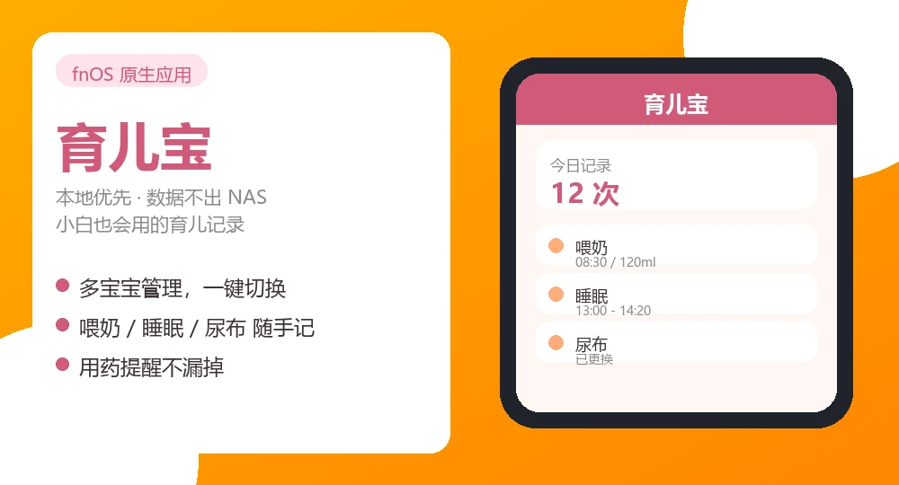

# BabyCare (BabyCare-FPK) - Native Parenting App for fnOS

**Language / 语言**: [简体中文](README.md) | [English](README_EN.md)

## Introduction

BabyCare (育儿宝) is a native NAS parenting app for the fnOS platform (by fnOS / 飞牛), designed for families running a fnOS NAS. It is **local-first**: all parenting data — growth records, feeding logs, diaries, photos — stays entirely on your own NAS. Nothing is uploaded to third-party clouds, so your family's parenting data remains a truly private digital space.

> **Note**: This app is unrelated to the Chinese mobile app "育儿宝" (YuErBao) by Beibei Group. It is an independent open-source product running on fnOS NAS.

## Screenshots




## Core Features

### 📊 Growth Records
- Height, weight and head-circumference tracking with WHO growth curves (percentiles)
- Automatic BMI calculation, growth-velocity tracking and record-correlation analysis
- Side-by-side photo management
- **Baby timeline**: browse every record by type and time range
- Stage reports: sleep / feeding / diaper / growth analysis
- **Weekly / monthly report**: key metrics for the current period plus a
  comparison against the previous one
- Annual growth report (with an AI-generated summary)
- **Print / save the clinic summary as PDF** — recent temperature, medication,
  allergies and vaccines on one sheet to hand to the doctor

### 🍼 Care Tracking
- Feeding logs (breast milk / formula / solids, with intake amount and nursing side)
- Sleep logs (sessions, quality, automatic statistics)
- Diaper change logs (wet / dirty / mixed)
- Pumping logs and tummy-time training records

### 🏥 Health Records
- Checkup records, temperature monitoring, medication logs
- Vaccine management: schedule, manufacturer / batch / dose, reactions, antibody results
- Allergy tests, allergy history, fontanelle checks, teething records
- Lab indicators (name / value / reference range / abnormal flag)
- Vision and hearing screening results, including referral notes
- **Follow-up planning**: 12 routine + 6 preterm checkup slots with due
  reminders, automatically reconciled once a checkup is logged
- **Reminders**: feeding / diaper / medication / vaccine / checkup and custom health reminders
  (WeChat · DingTalk · Feishu · Bark · PushPlus, with do-not-disturb hours)
  ⚠️ Medication and checkup reminders are driven by the reminder configuration; the
  `next_dose_time` column on `medication_records` is a legacy field and is not scheduled

### 🎯 Development Assessment
- Developmental milestone tracking (with a "first time" flag)
- Milestone details (code / expected month age / status)
- **ASQ result entry** (five domain scores plus conclusion)
  ⚠️ The app ships **no ASQ items and no scoring algorithm** — the ASQ questionnaire
  must be purchased from its publisher. Record the scores and conclusion here
  (normal / monitor / refer); no automatic scoring is performed.
- Developmental leap tracking (1–10)

### ✍️ Parenting Diary
- Capture your baby's growth moments, with simple Markdown formatting and inline photos
- Upload comparison photos (photos can be embedded in the diary text)
- AI-assisted diary writing
- **On this day**: what happened on the same day in previous years
- **Global search** across diaries, feeding logs, health records and more

### 🤖 AI-Assisted Parenting
- Smart summaries of growth records
- Parenting suggestions
- Photo content description
- Q&A
- **In-chat quick logging**: talk to the Xiaomeng bubble and it records —
  say "just had 120ml of formula" and the AI detects the record type,
  extracts the fields and shows a confirmation card; nothing is saved
  until you tap "Save". Authorization toggle in Settings → AI LLM (on by default)

### 📚 Parenting Knowledge Base
- Built-in articles on feeding, sleep, development, health and care
- Solid-food recipe recommendations (difficulty / nutrition / tips)
- Parent-child activity library (indoor/outdoor, seasonal), with favorites and completion log
- **This month at a glance**: age-tailored highlights (development · vaccines ·
  play · first foods · common questions · home safety · warning signs · first
  aid) — advisory only, never a diagnosis, and never any medication dosage

### ⏱️ Tools
- Feeding timer, sleep timer (can auto-create records on stop)
- Soothing sounds (synthesised locally, no external audio files)
- **Family members & recorder**: tag who logged each record
- **Daily milk target**: estimated from age and weight, or customised to a
  doctor's plan (30-3000 ml), with progress at a glance
- **Custom countdowns**: pin "days remaining" (follow-ups, due dates, ...)
  on the dashboard
- Diaper price comparison and expense tracking
- Data export: per-baby JSON, full JSON, vaccine CSV
- ZIP backup / restore including photo albums, export to / restore from fnOS shared folders
  ⚠️ "Restore" consumes backup archives produced by this app; there is **no generic import**
- Delete safety code: required before deleting a baby or restoring a backup
- Integration API token (used by external integrations such as Home Assistant)
- **Inbound webhook**: a "one call, one entry" channel for bedside buttons,
  voice assistants and automation scripts (feeding / diaper / sleep /
  temperature). Uses its own token that can be revoked independently of the
  integration token, with a field whitelist, numeric clamping, rate limiting
  and a call audit log

### 🏠 Smart Home
- Built-in Home Assistant integration (`ha-integration/`): sensors, services, timer switches
- One baby = one device; entities are grouped under the matching baby device
- **Quick-record buttons**: "log breastfeeding" / "log diaper change" — one tap
  writes a record (great for dashboard cards, NFC stickers, voice assistants)
- **Today's diaper count** sensor
- When the token expires, HA re-authenticates in place — no need to remove and re-add
  the integration (entity IDs stay stable)
- The integration token can read data and write records only; it cannot change settings,
  delete a baby or touch backups
- Token auth; data still stays on your local NAS

## AI Features

BabyCare can integrate LLM capabilities in two modes:

### 1. Online API Mode
Calls external online LLM services (e.g. DeepSeek, Kimi, OpenAI).

⚠️ **Privacy notice**: when a third-party online API is selected, data such as baby photos, diaries and feeding logs is transmitted to that provider's servers and leaves your NAS. Use with care for highly sensitive information.

### 2. Locally Deployed LLM Mode (recommended, privacy-first)
The model runs on the NAS hardware itself; all AI inference stays local. Baby data never leaves your device, fully preserving the local privacy advantage.

See the [Privacy Policy](PRIVACY.md) and [User Agreement](USER_AGREEMENT.md) for details.

## Tech Stack

- **Backend**: Python Flask + Gunicorn + SQLite
- **Frontend**: vanilla HTML/CSS/JavaScript (responsive design)
- **Access**: fnOS gateway (Unix Socket)
- **Storage**: SQLite database + fnOS data directory
- **AI**: OpenAI-compatible APIs and local Ollama

## Project Structure

```
babycare-fpk/
├── manifest              # App package descriptor
├── NOTICE                # Third-party components & data attribution
├── README.md             # Project intro (Chinese)
├── USER_AGREEMENT.md     # User agreement
├── PRIVACY.md            # Privacy policy
├── LICENSE               # Apache-2.0
├── cmd/                  # Lifecycle scripts (main/install/upgrade/uninstall/config)
├── config/               # Runtime permissions & resources (shared folders / API scope)
├── wizard/               # Install/uninstall wizard
├── ha-integration/       # Home Assistant custom integration
├── app/
│   ├── backend/          # Python backend
│   │   ├── server.py     # Flask entry point
│   │   ├── ai_engine.py  # AI engine (local rule engine + LLM integration)
│   │   ├── growth_utils.py / who_data.py   # WHO growth standards math & data
│   │   ├── blueprints/   # Route modules
│   │   └── vendor/       # Offline dependencies (Flask & co., see NOTICE)
│   ├── frontend/         # Frontend pages (vanilla HTML/CSS/JS, responsive)
│   ├── ui/               # fnOS desktop entry
│   └── data/             # Data directory (generated at runtime)
├── ICON.PNG              # App icon
└── ICON_256.PNG          # App icon (256x256)
```

## Local Development

```bash
cd app/backend
pip install -r requirements.txt
python3 server.py    # default http://localhost:8090, override with BABYCARE_PORT
```

Local development mode disables passwordless login by default: set the environment
variable `BABYCARE_DEV_AUTH=1`, then log in via `POST /api/auth/login`. On fnOS
production the gateway handles authentication, so this switch is not needed.

## Packaging

```bash
fnpack build -d babycare-fpk
# produces babycare-fpk.fpk
```

Note: when packing on Windows, the exec bits of the lifecycle scripts inside the
package must be fixed to 0755 (Windows filesystems do not preserve Unix exec
bits), otherwise the scripts cannot run on the fnOS device.

## License

This project is licensed under the [Apache License 2.0](LICENSE). Copyright 2026 xiaoke799.

## Privacy Policy

See the [Privacy Policy](PRIVACY.md). All data is stored locally; when online AI
features are used, some data may be sent to third-party providers.

## User Agreement

See the [User Agreement](USER_AGREEMENT.md).

## Data Compliance

- WHO growth reference data: [WHO Child Growth Standards](https://www.who.int/tools/child-growth-standards)
- Health encyclopedia content is for reference only and does not constitute medical advice
- When using online AI features, comply with the terms of the corresponding AI provider

## Versioning

Version numbers follow the `manifest` file and git tags; git commits and package
versions are independent — several development milestones may be merged into a
single release version.

- v0.0.1 (2026-09-13) - First open-source release (git tag v0.0.1)
- v0.0.2 (2026-10-03) - Content compliance and write-path hardening.
  Removed all concrete medication dosages and medical advice from the
  knowledge base, added the "This month at a glance" page, and fixed the
  silently dead reminder scheduler, silently aborted DB migrations, a
  webhook rate-limit bypass via forged X-Forwarded-For, indicator
  ownership loss on health-record edits, plus unified time formats and
  legacy data cleanup across all record write paths
- v0.0.3 (2026-10-16) - Feature completeness and release hygiene. Added
  the AI writer page (11 scenarios), daily milk target (estimated +
  doctor-customised), follow-up planning (12 routine + 6 preterm slots)
  with post-checkup reconciliation, custom countdowns, a next-follow-up
  dashboard chip, and Home Assistant quick-record buttons plus a
  today-diaper-count sensor. Fixed report charts staying empty due to
  field-name mismatches and fabricated "healthy rhythm" conclusions with
  no data. API failures are now visible in the UI. Global typography
  polish and unified card layout. Documentation and version numbers
  brought back in sync
- v0.0.4 (2026-10-17) - In-chat quick logging via the Xiaomeng bubble.
  Speak directly in the floating chat to log: the AI detects one of 11
  record types (feeding / sleep / diaper / growth / temperature /
  medication / vaccine / pumping / milestone / teething / allergy test),
  extracts the fields and pops a "Record this?" card showing the parsed
  result with yes/no; nothing is written unless you tap "Save". New
  authorization toggle in Settings → AI LLM (on by default); unauthorized
  requests are rejected with HTTP 403
- v0.0.5 (2026-10-17) - UI and information-architecture pass (cumulative
  since v0.0.4). **UI**: the home page is built from rows (greeting → search &
  date → 5 quick-log buttons → "on this day" → today's summary beside the milk
  target → body measurements beside upcoming reminders → recent records),
  fixing three structural bugs: desktop quick buttons were too narrow and
  wrapped "Feeding" onto two lines, the two-column layout left ~150px of dead
  space at the bottom left, and on mobile the search bar jumped above the
  greeting. On desktop the app column is now a centred panel floating on a
  canvas — it keeps visible side margins even when the window is not maximised —
  and the record / growth / knowledge / system grids use three columns instead
  of two 500px ones where each group's 1~3 icons hugged the left edge and left
  a hole in the middle and on the right. Summary cards lose three colour bars
  that carried no meaning, and block spacing is now a single step. The install
  wizard's agreement step now puts the "I accept the terms" checkbox above the
  terms text so it is always visible, with the full text scrollable underneath
  (and still available in Settings → Privacy & Terms) — the fnOS wizard drops
  container border/scroll styles, so a checkbox below the long text was pushed
  below the fold and "Next" silently did nothing. The About page version now comes only from the backend
  instead of being hard-coded.
  **Information architecture**: the health follow-up plan moved out of the
  clinic summary into Health Record → Follow-up (right after Checkups), and the
  custom countdown moved out of the summary into its own page under a new
  "Tools" group in the Record tab (soothing sounds moved there from System as
  well) — the clinic summary is a retrospective report for the doctor, while
  follow-ups and countdowns are the parent's own future schedule and private
  events. Print output now whitelists only the summary body.
  **Logging entry**: removed the standalone AI writer page and the "Smart" nav
  group (one-sentence logging is now handled by the in-chat confirmation card;
  diary drafting, weekly summaries and milestone suggestions went with the
  page, backend AI endpoints are kept for future use). The AI tool-calling path
  no longer writes records directly: previously the model could silently log a
  sentence without confirmation and duplicate the confirmation card, now all
  new records go through detect → yes/no card → tap "Save", with no bypass.
  Queries and analysis are unaffected. Also fixed countdown ordering: it was
  sorted by date ascending only, so already-past events sat at the very top;
  past ones now sink to the bottom
